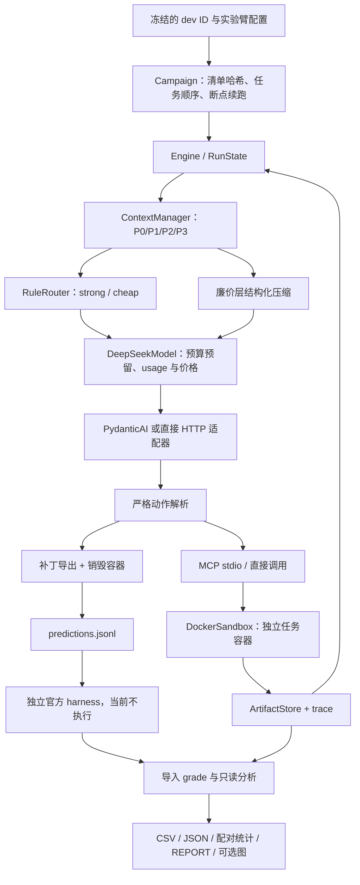

# ctxroute 架构与实验代码

当前交付为代码，不含真实实验结果。2026-10-23 已完成本地依赖与 API 联调，当前按用户要求继续编写代码、减少测试。benchmark 配置仍为 `offline_only`；API 预算开关保留此前已授权的 `true`，本轮不调用 API。

## 模块职责

| 模块 | 已编写的行为 |
|---|---|
| `domain.py` / `config.py` | Task、Action、Observation、RunState、请求与响应；严格动作字段；实验臂和预算配置 |
| `orchestrator/engine.py` | ReAct 循环、格式纠错、最多两次请求尝试、步数/时间/费用终止、最终补丁与清理 |
| `context/manager.py` | P0 系统与任务、P1 固定记忆、P2 五字段摘要、P3 最近 K 步；70%/90% 阈值、usage 校准、批量压缩、只接受缩小的摘要 |
| `context/memory.py` | v2 嵌套摘要 schema、类型/范围校验及证据 ID 引用；P1 保存有原始输出依据的历史观察 |
| `context/artifacts.py` | 内容寻址、全文落盘、头尾截断、字符范围 recall、引用固定和容量限制 |
| `router/rules.py` | 上一步分类、连续无失败后降级、编辑/测试失败/工具错误/格式错误升级、5 步 strong 锁定 |
| `models/` | 统一请求协议；DeepSeek 预算网关；可选 PydanticAI 适配器；离线固定响应替代实现 |
| `tools/` | MCP stdio 客户端与服务端；create_sandbox、exec、get_patch、destroy；模型只接触 bash/recall |
| `sandbox/` | 固定镜像摘要、禁网、资源限制、命令/输出限制、所属容器清理；直接/MCP 时延测量代码 |
| `tracing/` | Decimal 缓存成本、SQLite 全局及任务预算、逐请求/逐步记录、状态与配置快照 |
| `evalkit/campaign.py` | 固定 dev 前缀计划、输入哈希、进程互斥、完整任务级续跑、剩余实验组费用检查 |
| `evalkit/workflow.py` | prepare/infer/export/analyze 分阶段复现、按臂预测交接、哈希核对与报告归档；不启动判分 |
| `evalkit/export.py` | 同一臂/变体/seed 的预测合并、官方 harness argv 生成；不会自动判分 |
| `evalkit/analysis.py` | 判分导入、token/缓存/成本上界/延迟/错误/重复读取统计、缺失记录、报告与失败案例表 |
| `evalkit/statistics.py` | 单 seed 精确 McNemar、按实例聚合后的配对 bootstrap、成本与延迟中位比值 |
| `evalkit/baseline.py` | A0 原生轨迹及规范化证据导入，保留上游版本和文件哈希 |
| `evalkit/plots.py` | 可选 matplotlib 成本–pass@1 图导出；当前未安装/运行该依赖 |

## 实验臂

A1 为强模型固定层；A2 加结构化摘要；A3 加规则路由；A4 同时开启两项；A5 固定廉价层。每臂独立配置位于 `configs/arms/`，核心循环相同。`configs/ablations/` 提供 A2/A4 仅截断变体，manifest 的 variant 区分 `main` 与 `truncate`。压缩臂的 recall 工具差异仍是实验混杂因素。

A0 已通过 `baselines/mini.py` 接入统一运行入口，直接使用固定版本的原生 DefaultAgent、文本动作解析与观测格式化函数，以预算模型网关和现有沙箱替换 I/O。它保留原生文本基线，但不是未经配置改动的上游 CLI。提示、动作协议、输出截断与传输方式仍与 A1 有差异，主因果对照继续使用 A1。真实兼容性及 A0/A1 一致性未验证，详见 [A0_ADAPTER](A0_ADAPTER.md)。

A6 多 Agent/A2A、A7 外部 harness、学习路由与本地模型按既有缩减决定后置。A6/A7 配置用于保留定义，执行器明确拒绝这些臂；没有以占位文件宣称实现协议。

## 运行与恢复语义

计划写入 config、价格、划分及预注册哈希，并冻结源代码指纹；含 A0 时同时冻结上游策略。执行前校验，参数变化必须建立新清单。当前仅允许固定 seed、dev 前 1–5 项；清单生成本身不代表授权执行。计划与实例的组合确定 run_id。

完整任务已落盘则续跑时跳过；进程中断但未完成的任务保留原目录与费用预留，停止并要求先对账，不自动重复付费。这是任务级续跑，不是容器中途状态恢复。成功、失败、空补丁和预算终止都保留证据。变更后的任务输入不得沿用原 run_id。

主执行默认选择 MCP + PydanticAI，二者均延迟导入。直接 Docker 函数调用和 HTTP 传输可作为诊断选项，在 manifest 留痕。当前 benchmark 配置拒绝真实任务执行；固定 API 探针此前已单独联调。运行入口不会安装 SDK、下载镜像或创建云资源。

## 预算、隔离与证据

所有 action、压缩及重试请求经过同一 ledger；每次派发前预留，全局预算包括外部登记的云费用。未知 usage 不补零，跨进程崩溃后仍保留预留。输入 token 护栏是工程约束，不是供应商保证；超出后记录并锁停，无法撤销已产生费用。

API usage 的高峰成本上界、确定非高峰时的结算与真实账单分开。报告中的 `cost_upper_usd` 不是账单。无 usage 的请求保留未知状态，不能进入完整费用配对。

任务 JSONL 只接受四个字段：instance_id、repo、base_commit、problem_statement。判分文件只由离线分析入口读取。容器不挂载宿主目录、不传入密钥、不允许联网；镜像应在后续环境阶段独立审计，代码无法证明镜像内部没有答案。命令超时或输出超限时停止该任务并销毁容器，可能无法回收其补丁，记录原因。

每个运行目录包含 manifest、traces、requests、lifecycle、状态/任务/配置快照、artifacts 与 predictions。`grade.json` 关联预测文件哈希和操作者提供的官方报告哈希；它提供可追溯关联，不自动证明报告的来源或对应补丁，实际判分阶段须核对官方 run_id。

## 实现取舍与验证边界

核心状态使用标准库 dataclass 和显式校验。PydanticAI 传输已通过固定短请求联调；MCP stdio 握手和四方法发现通过，Docker 操作与实际任务生命周期未测。结构化记忆已细分文件/行范围、命令/退出码、假设/证据、编辑/统计，采用共享 JSON Schema 与宿主严格校验，不宣称供应商原生 constrained decoding。P1 观察引用与迁移边界见 STRUCTURED_MEMORY.md。

标准库 JSONL/CSV 为默认分析产物；Parquet、DuckDB 不在当前主线实现内。重复读取统计以重复只读命令作为代理，不能覆盖同一文件不同命令的所有重复读取。H1 输出按轨迹长度分组的观察性计数，不作因果拟合。

没有采集 benchmark 结果，不给成功率、成本节省或真实性能数字。API、官方 harness 和 A0 运行依赖已经安装，固定 API 请求通过；Docker 环境、图形依赖及可选扩展仍待相应阶段。分阶段复现入口见 REPRODUCE.md。
