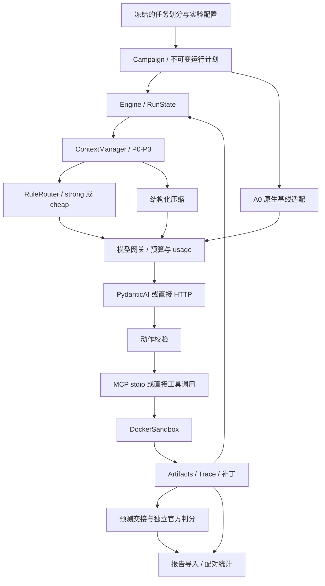

# 架构

ctxroute 将软件工程 Agent 的任务执行、上下文管理、模型路由、隔离工具和实验分析拆分为可配置模块。核心状态使用标准库 dataclass，模型与沙箱通过接口注入。

## 模块

| 路径 | 职责 |
|---|---|
| [`domain.py`](../src/ctxroute/domain.py)、[`config.py`](../src/ctxroute/config.py) | 任务、动作、观察、运行状态及严格配置校验 |
| [`orchestrator/`](../src/ctxroute/orchestrator/) | Agent 循环、格式纠错、进展与重复动作控制、终止及清理 |
| [`context/`](../src/ctxroute/context/) | 分区上下文、结构化记忆、压缩、artifact 存储与 recall |
| [`router/`](../src/ctxroute/router/) | 命令分类、模型层级决策与强模型锁定 |
| [`models/`](../src/ctxroute/models/) | 预算网关、HTTP/PydanticAI 传输及离线固定响应模型 |
| [`tools/`](../src/ctxroute/tools/) | MCP stdio 客户端、服务端和工具服务 |
| [`sandbox/`](../src/ctxroute/sandbox/) | Docker 生命周期、隔离约束、超时及输出限制 |
| [`tracing/`](../src/ctxroute/tracing/) | 预算账本、缓存感知成本、请求与步骤记录 |
| [`baselines/`](../src/ctxroute/baselines/) | 固定版本 mini-swe-agent 原生文本适配 |
| [`evalkit/`](../src/ctxroute/evalkit/) | 任务划分、清单、调度、预测交接、报告导入与统计 |
| [`configs/`](../configs/) | 实验臂、消融、运行时、沙箱和预算配置 |

## 上下文与路由

上下文分为 P0 系统提示、任务与运行状态，P1 固定历史观察，P2 结构化工作记忆，以及 P3 最近步骤。达到软阈值时批量处理较早步骤，保留最近 K 步；摘要需通过 schema、证据引用与缩小检查。达到硬阈值仍无法回收上下文时终止。token 估算根据实际 usage 向上校准。

规则路由默认选择强模型。近期步骤无错误、上一动作属于只读、上下文符合阈值且无强模型锁时，可选择廉价模型。编辑或未知命令、测试失败等事件会触发强模型锁。命令分类仅用于路由，不是安全边界。

具体接口见 [STRUCTURED_MEMORY](STRUCTURED_MEMORY.md)、[ACTION_PROTOCOL](ACTION_PROTOCOL.md) 和 [PROGRESS_CONTROL](PROGRESS_CONTROL.md)。

## 实验臂

| 实验臂 | 执行方式 |
|---|---|
| A0 | mini-swe-agent 原生文本循环，固定强模型 |
| A1 | ctxroute 循环，固定强模型，不压缩 |
| A2 | A1 加结构化压缩 |
| A3 | A1 加规则路由 |
| A4 | 结构化压缩与规则路由 |
| A5 | ctxroute 循环，固定廉价模型 |

[`configs/ablations/`](../configs/ablations/) 提供 A2/A4 的仅截断变体。A0 的提示、动作协议与观测呈现不同于 A1，因此压缩和路由的主要对照以 A1 为基线。A6 多 Agent/A2A、A7 外部 harness 配置仅保留扩展定义，执行器拒绝运行；学习路由与本地模型没有对应执行实现。

## 运行身份与恢复

计划冻结源码指纹、配置、价格、划分和实验协议哈希；包含 A0 时还冻结上游策略。计划与任务序号确定 `run_id`。参数或实现变化时需创建新计划。

恢复以完整任务为单位：已有完成记录的任务可跳过，中断任务保留目录和费用预留，不自动重复派发请求。失败、空补丁和预算终止都保留在计划集合中。它不恢复容器内的中途状态。

## 隔离与记录

任务输入仅包含 `instance_id`、`repo`、`base_commit`、`problem_statement`。任务容器固定镜像摘要，禁网、禁宿主挂载和密钥传入，并限制资源、命令时间与输出。镜像内容仍需独立审计；容器隔离本身不证明镜像没有答案泄漏。

模型动作、压缩及重试共用预算账本，请求前预留，未知 usage 保留未结算状态。每个运行目录保存 manifest、trace、requests、生命周期、状态、配置快照、artifacts 和预测。官方判分在独立环境执行，导入时关联预测与报告哈希。

分析以 JSONL/CSV 为默认产物，提供配对 bootstrap、精确 McNemar、成本与延迟统计，以及可选 matplotlib 图导出。统计方法与缺失处理见 [PREREG](PREREG.md)，运行入口见 [REPRODUCE](REPRODUCE.md)。
